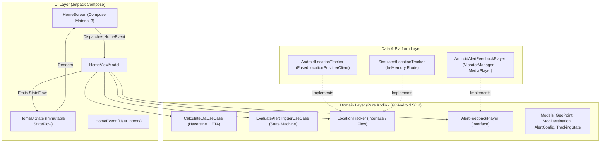

# NapStop 🛑

🇧🇷 [Leia em Português](README.md)

[](https://kotlinlang.org/)
[](https://developer.android.com/jetpack/compose)
[]()
[](https://github.com/Kotlin/kotlinx.coroutines)
[]()
[]()

> **Smart public transit alarm based on geolocation and dynamic Estimated Time of Arrival (ETA), built with Kotlin, Jetpack Compose, and Clean Architecture.**  
> Designed so daily commuters can relax or nap during transit without the fear of missing their stop.

---

## 🎯 Problem & Solution

### The Real-World Problem
Commuters on buses, subways, or trains frequently nap, read, or listen to music during daily transit. Traditional fixed-time alarms fail in urban commutes because traffic congestion, traffic lights, and route detours make arrival times unpredictable. Conversely, fixed-radius proximity alarms (e.g., 500 meters) trigger either too early along high-speed corridors or too late in bumper-to-bumper city traffic.

### How NapStop Solves It
**NapStop** continuously tracks the vehicle's position in real time and calculates dynamic **Estimated Time of Arrival (ETA)** using the **Haversine formula** combined with current travel velocity (with a defensive 25 km/h urban fallback when stationary). The application operates a progressive two-stage alert system:

1. **Vibration Pre-Alert (`VibrationTriggered`):** A gentle haptic pattern (three distinct pulses) triggers ahead of arrival (configurable, e.g., 10 minutes before destination), waking the passenger smoothly.
2. **Critical Audio & Haptic Alarm (`AlarmTriggered`):** Upon reaching the critical proximity threshold (e.g., 5 minutes before arrival), the app triggers continuous vibration alongside the device's native alarm sound via `AudioAttributes.USAGE_ALARM` and `CONTENT_TYPE_SONIFICATION`, ensuring audibility even if system media volume is lowered.

---

## 🏛 Architecture & Engineering Decisions

NapStop strictly adheres to **Clean Architecture**, **SOLID principles**, and **Unidirectional Data Flow (UDF)**.

### Data Flow & Layer Diagram



### Engineering Highlights

- **100% Android-Free Domain Layer:** The entire `domain` package (`model`, `repository`, `usecase`, `alert`) consists strictly of pure Kotlin code with **zero** imports from `android.*` (`Context`, `Location`, etc.). This guarantees instant JVM unit testing and readies the business logic for future **Kotlin Multiplatform (KMP)** adoption.
- **Defensive Domain Models:**
  - `GeoPoint`: Validates coordinate boundaries in its `init` block (`latitude in -90.0..90.0` and `longitude in -180.0..180.0`).
  - `AlertConfig`: Enforces positive lead times and the core business constraint: `vibrationLeadTimeMinutes > alarmLeadTimeMinutes`.
  - `StopDestination`: Sanitizes raw user input via `sanitizeName`, stripping redundant whitespace and non-printable control characters.
- **Unidirectional Data Flow (UDF):** The screen state (`HomeUiState`) is fully immutable (`val`). State changes occur solely through explicit user intents (`HomeEvent`), processed inside `HomeViewModel` and exposed through `StateFlow`.
- **Manual Dependency Injection (`AppContainer`):** Implemented without the overhead of heavy reflection or annotation processors, centralized in `NapStopApplication` following the **Dependency Inversion Principle (DIP)**. Facilitates immediate test double injection during instrumented UI testing.
- **Resource Management & Leak Prevention:** `AndroidLocationTracker` leverages Kotlin's `callbackFlow` with an `awaitClose { fusedLocationClient.removeLocationUpdates(...) }` block, guaranteeing that hardware GPS tracking is stopped the moment monitoring is cancelled or the coroutine scope ends.

---

## 🔒 Privacy & Security by Design

- **Zero Personal Data Collection:** NapStop requires no registration, logins, telemetry trackers, or external cloud integrations.
- **Ephemeral In-Memory GPS Processing:** GPS coordinates are processed exclusively in volatile RAM to compute distance and ETA in real time. No coordinates, route histories, or stop points are persisted to local storage, SQLite/Room, or remote servers.
- **Release Log Sanitation:** ProGuard/R8 configuration (`-assumenosideeffects class android.util.Log { ... }`) strips all logging invocations in release builds, preventing accidental geographic data leaks.
- **Code Hardening (ProGuard/R8):** Release builds enforce minification and obfuscation (`isMinifyEnabled = true`) with tailored rules protecting domain models and application entry points.

---

## 🛠 Tech Stack

| Category | Technology / Library | Version | Role in Project |
|---|---|---|---|
| **Language** | Kotlin | 2.2.10 | Modern, expressive, and type-safe language |
| **UI Toolkit** | Jetpack Compose (BOM) | 2026.02.01 | Declarative UI toolkit with Material Design 3 |
| **Architecture** | Clean Architecture + MVVM + UDF | - | Layer decoupling and high testability |
| **Concurrency** | Coroutines & Flow | 1.9.0 | Asynchronous routines and reactive location streams |
| **Lifecycle** | Lifecycle ViewModel & Compose | 2.11.0 | Lifecycle-aware UI state management |
| **Location Tracking** | Play Services Location | 21.3.0 | High-accuracy real-time `FusedLocationProviderClient` |
| **Audio & Haptics** | AudioAttributes & VibratorManager | API 26+ | Native `USAGE_ALARM` audio routing & custom vibrations |
| **Unit Testing** | JUnit 4, MockK, Coroutines Test | 4.13.2 / 1.13.12 | JVM unit testing for UseCases and ViewModels |
| **UI / E2E Testing** | AndroidX Compose UI Test JUnit4 | BOM | Instrumented automated UI and full journey testing |

---

## 🧪 Testing Strategy

NapStop adopts a structured testing pyramid combining fast JVM unit tests with full End-to-End (E2E) instrumented UI tests:

```
          / \
         /   \      E2E / UI Tests (src/androidTest)
        /  ▲  \     NapStopEndToEndTest (ComposeRule + Dynamic GPS Progression)
       /───────\
      /    ▲    \   Unit Tests (src/test)
     /     │     \  CalculateEtaUseCaseTest, EvaluateAlertTriggerUseCaseTest,
    /─────────────\ HomeViewModelTest (MockK + runTest with StandardTestDispatcher)
```

### Unit Tests (`app/src/test`)
- **`CalculateEtaUseCaseTest`:** Validates Haversine formula precision (e.g., real-world distance between São Paulo and Rio de Janeiro), zero-distance scenarios, and defensive fallback speed (25 km/h) when the vehicle is stationary.
- **`EvaluateAlertTriggerUseCaseTest`:** Validates deterministic state machine transitions (`Idle` $\rightarrow$ `Monitoring` $\rightarrow$ `VibrationTriggered` $\rightarrow$ `AlarmTriggered`), boundary thresholds, and `AlertConfig` constraints.
- **`HomeViewModelTest`:** Tests reactive state emission using `kotlinx-coroutines-test`, input sanitization, and verifies that `AlertFeedbackPlayer.triggerVibration()` and `AlertFeedbackPlayer.triggerAlarm()` are invoked at exact ETA thresholds.

### Instrumented & E2E Tests (`app/src/androidTest`)
- **`NapStopEndToEndTest`:** Employs `createComposeRule()` to validate the complete passenger journey:
  1. Setting up stop coordinates and alert thresholds via UI inputs or quick presets.
  2. Starting monitoring.
  3. Injecting a progressive simulated GPS stream (`ControllableLocationTracker`): distant position $\rightarrow$ vibration zone $\rightarrow$ audible alarm zone.
  4. Asserting status card UI updates and verifying invocation of `AlertFeedbackPlayer`.
  5. Stopping monitoring and verifying that physical feedback stops immediately.

### Test Execution Commands

Run all unit tests on the JVM:
```bash
./gradlew testDebugUnitTest
```

Run instrumented UI and E2E tests on a connected device or emulator:
```bash
./gradlew connectedDebugAndroidTest
```

---

## 🚀 How to Run & Simulate a Bus Route

### Prerequisites
- Android Studio Ladybug / Meerkat (or newer)
- Android SDK 37 installed
- Android Emulator or physical device running Android 8.0+ (API 26+)

### Step-by-Step Setup
1. Clone the repository and navigate into the root directory:
   ```bash
   git clone https://github.com/leonardovictormuller/NapStop.git
   cd NapStop
   ```
2. Open the project in **Android Studio**.
3. Select your target device or emulator and click **Run 'app'** (`Shift + F10`).

### Simulating a Bus Route in the Android Emulator
You can test the real GPS tracking and progressive alerts directly on your emulator:

1. Open **NapStop** inside the Android Emulator.
2. Tap one of the **Presets rápidos** buttons (e.g., **MASP** or **Estação Consolação**) to populate the coordinates.
3. Configure your alert lead times (e.g., Vibration at 10 min, Alarm at 5 min) and tap **Iniciar Monitoramento** (grant location permissions when prompted).
4. Open the emulator's **Extended Controls** (the `...` icon on the emulator sidebar).
5. Navigate to the **Location** tab:
   - Select the **Routes** sub-tab.
   - Enter a distant starting point (e.g., *Avenida Paulista, 2000*) and set the destination to match your selected stop.
   - Adjust the playback speed to simulate a moving bus.
   - Click **Play Route**.
6. Observe NapStop recalculating remaining distance and ETA with every GPS update, transitioning into the **📳 Vibração ativada!** card, and triggering the continuous **🚨 ALARME!** sound and vibration upon reaching the arrival threshold. Tap **Parar Monitoramento** to silence the alarm.
