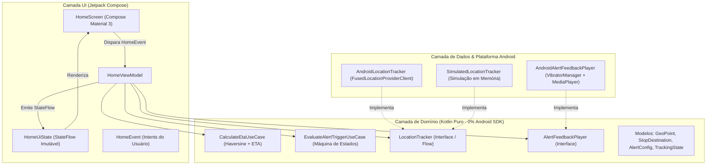

# NapStop 🛑

🇺🇸 [Read in English](README.en.md)

[](https://kotlinlang.org/)
[](https://developer.android.com/jetpack/compose)
[]()
[](https://github.com/Kotlin/kotlinx.coroutines)
[]()
[]()

> **Despertador inteligente para transporte público baseado em geolocalização e tempo estimado de chegada (ETA), construído com Kotlin, Jetpack Compose e Clean Architecture.**  
> Projetado para que passageiros possam relaxar ou dormir no trajeto sem o risco de perder seu ponto de descida.

---

## 🎯 Problema & Solução

### O Problema Real
Passageiros de ônibus, metrô ou trens frequentemente cochilam, leem ou escutam música em seus trajetos diários. Despertadores convencionais baseados em horário fixo são ineficazes em deslocamentos urbanos, onde o trânsito, semáforos e desvios tornam o tempo de percurso imprevisível. Por outro lado, alarmes de proximidade baseados exclusivamente em raio estático de geofence (ex: 500 metros) disparam cedo demais em vias rápidas ou tarde demais em congestionamentos intensos.

### Como o NapStop Resolve
O **NapStop** monitora em tempo real a posição do veículo e calcula o **Tempo Estimado de Chegada (ETA)** dinamicamente através da **Fórmula de Haversine** combinada com a velocidade de deslocamento (com fallback defensivo de 25 km/h para situações de tráfego parado). O sistema opera com alerta progressivo em dois estágios:

1. **Vibração Prévia (`VibrationTriggered`):** Um padrão haptic de três pulsos longos dispara com antecedência configurável (ex: 10 minutos antes do destino), despertando o usuário com suavidade.
2. **Alarme Crítico Sonoro e Físico (`AlarmTriggered`):** Ao atingir o limiar crítico (ex: 5 minutos antes), o app aciona vibração contínua e reproduz o alarme nativo do dispositivo configurado com `AudioAttributes.USAGE_ALARM` e `CONTENT_TYPE_SONIFICATION`, garantindo que o alerta soe mesmo se o volume de mídia do aparelho estiver reduzido.

---

## 🏛 Arquitetura & Decisões de Engenharia

O projeto foi construído seguindo rigorosamente **Clean Architecture**, princípios **SOLID** e **Unidirectional Data Flow (UDF)**.

### Fluxo de Dados e Camadas



### Destaques de Engenharia

- **Domínio 100% Desacoplado do Android SDK:** Todo o pacote `domain` (`model`, `repository`, `usecase`, `alert`) é composto exclusivamente por código Kotlin puro. Não há dependências de `android.*` (`Context`, `Location`, etc.), permitindo testes unitários instantâneos na JVM e viabilizando a futura migração para **Kotlin Multiplatform (KMP)**.
- **Modelos com Validação Defensiva:**
  - `GeoPoint`: Garante limites válidos no bloco `init` (`latitude in -90.0..90.0` e `longitude in -180.0..180.0`).
  - `AlertConfig`: Valida obrigatoriedade de tempos positivos e a regra de negócio central: `vibrationLeadTimeMinutes > alarmLeadTimeMinutes`.
  - `StopDestination`: Higieniza strings de entrada via `sanitizeName`, removendo espaços excedentes e caracteres de controle invisíveis.
- **Unidirectional Data Flow (UDF):** O estado da tela (`HomeUiState`) é totalmente imutável (`val`). Alterações ocorrem unicamente por eventos explícitos (`HomeEvent`), processados no `HomeViewModel` e expostos através de `StateFlow`.
- **Injeção de Dependência Manual (`AppContainer`):** Implementada sem o overhead de frameworks pesados de reflexão ou anotações, centralizada na classe `NapStopApplication` e respeitando o **Princípio da Inversão de Dependência (DIP)**. Facilita a substituição imediata de implementações em testes instrumentados.
- **Gerenciamento Seguro de Recursos (Leak Prevention):** O `AndroidLocationTracker` utiliza `callbackFlow` com bloco `awaitClose { fusedLocationClient.removeLocationUpdates(...) }`, assegurando que o GPS do aparelho seja desligado assim que a corrotina é finalizada ou o monitoramento é interrompido.

---

## 🔒 Privacidade & Segurança by Design

- **Zero Coleta de Dados Pessoais:** O NapStop não possui cadastro, login, telemetria analítica ou integração com servidores de terceiros.
- **Processamento Efêmero em Memória:** As coordenadas emitidas pelo GPS são processadas exclusivamente na memória RAM para cálculo do ETA em tempo de execução. Nenhuma coordenada, histórico de rotas ou pontos de parada são salvos em banco de dados local ou disco.
- **Sanitização de Logs em Release:** O arquivo `app/proguard-rules.pro` contém regras explícitas (`-assumenosideeffects class android.util.Log { ... }`) que removem chamadas de log em builds de release, eliminando o risco de exposição acidental de localização.
- **Proteção de Código (ProGuard/R8):** Ofuscação e minificação ativadas (`isMinifyEnabled = true`) para builds de release com proteção estruturada para modelos de domínio e pontos de entrada do aplicativo.

---

## 🛠 Tech Stack

| Categoria | Tecnologia / Biblioteca | Versão | Função no Projeto |
|---|---|---|---|
| **Linguagem** | Kotlin | 2.2.10 | Código seguro, expressivo e moderno |
| **UI Toolkit** | Jetpack Compose (BOM) | 2026.02.01 | Construção declarativa de interface com Material Design 3 |
| **Arquitetura** | Clean Architecture + MVVM + UDF | - | Desacoplamento e testabilidade em camadas |
| **Concorrência** | Coroutines & Flow | 1.9.0 | Processamento assíncrono e fluxos reativos de localização |
| **Lifecycle** | Lifecycle ViewModel & Compose | 2.11.0 | Gerenciamento de estado vinculado ao ciclo de vida da Activity |
| **Localização GPS** | Play Services Location | 21.3.0 | `FusedLocationProviderClient` de alta precisão em tempo real |
| **Áudio & Vibração** | AudioAttributes & VibratorManager | API 26+ | Disparo de alarme com `USAGE_ALARM` e controle haptic |
| **Testes Unitários** | JUnit 4, MockK, Coroutines Test | 4.13.2 / 1.13.12 | Testes de UseCases e ViewModels na JVM |
| **Testes E2E / UI** | AndroidX Compose UI Test JUnit4 | BOM | Automação e testes instrumentados de tela e jornada completa |

---

## 🧪 Estratégia de Testes

O projeto adota uma pirâmide de testes consistente que combina testes unitários rápidos na JVM com testes instrumentados de ponta a ponta (E2E):

```
          / \
         /   \      Testes E2E / UI (src/androidTest)
        /  ▲  \     NapStopEndToEndTest (ComposeRule + Sequência GPS Dinâmica)
       /───────\
      /    ▲    \   Testes Unitários (src/test)
     /     │     \  CalculateEtaUseCaseTest, EvaluateAlertTriggerUseCaseTest,
    /─────────────\ HomeViewModelTest (MockK + runTest com StandardTestDispatcher)
```

### Testes Unitários (`app/src/test`)
- **`CalculateEtaUseCaseTest`:** Valida a precisão da fórmula de Haversine (ex: distância real entre São Paulo e Rio de Janeiro), cenários de distância zero e velocidade nula com fallback defensivo para 25 km/h.
- **`EvaluateAlertTriggerUseCaseTest`:** Valida as transições estritas da máquina de estados (`Idle` $\rightarrow$ `Monitoring` $\rightarrow$ `VibrationTriggered` $\rightarrow$ `AlarmTriggered`), limites exatos de minutos e regras de integridade do `AlertConfig`.
- **`HomeViewModelTest`:** Testa o fluxo completo de emissão de estados via `StateFlow`, higienização de inputs e confirma que os métodos `AlertFeedbackPlayer.triggerVibration()` e `AlertFeedbackPlayer.triggerAlarm()` são chamados nos momentos exatos da aproximação.

### Testes Instrumentados & E2E (`app/src/androidTest`)
- **`NapStopEndToEndTest`:** Utiliza o `createComposeRule()` para validar a jornada completa do passageiro:
  1. Configuração do ponto de parada e tempos de alerta pelos componentes de tela ou botões de preset.
  2. Início do monitoramento.
  3. Injeção de sequência progressiva de coordenadas GPS (`ControllableLocationTracker`): ponto distante $\rightarrow$ zona de vibração $\rightarrow$ zona de alarme sonoro.
  4. Validação da transição visual dos cards de status e verificação do acionamento do `AlertFeedbackPlayer`.
  5. Interrupção do monitoramento e garantia do silenciamento dos alertas.

### Comandos para Execução dos Testes

Executar todos os testes unitários:
```bash
./gradlew testDebugUnitTest
```

Executar os testes de interface instrumentados (E2E) em emulador ou dispositivo conectado:
```bash
./gradlew connectedDebugAndroidTest
```

---

## 🚀 Como Executar & Simular uma Rota de Ônibus

### Pré-requisitos
- Android Studio Ladybug / Meerkat (ou superior)
- Android SDK 37 configurado
- Emulador Android ou dispositivo físico rodando Android 8.0 ou superior (API 26+)

### Passo a Passo de Execução
1. Clone o repositório e acesse a pasta raiz:
   ```bash
   git clone https://github.com/leonardovictormuller/NapStop.git
   cd NapStop
   ```
2. Abra o projeto no **Android Studio**.
3. Selecione o emulador ou aparelho desejado e clique em **Run 'app'** (`Shift + F10`).

### Simulando a Rota no Emulador Android
É possível simular o trajeto completo de um ônibus e conferir o disparo dos alertas em tempo real:

1. Abra o **NapStop** no emulador Android.
2. Toque em um dos botões de **Presets rápidos** (ex: **MASP** ou **Estação Consolação**) para preencher as coordenadas de destino automaticamente.
3. Configure os tempos de alerta desejados (ex: Vibração em 10 min, Alarme em 5 min) e toque em **Iniciar Monitoramento** (conceda a permissão de localização quando solicitado).
4. Abra os controles estendidos do emulador (**Extended Controls**, ícone de `...` na barra lateral).
5. Navegue até a aba **Location**:
   - Vá na sub-aba **Routes**.
   - Defina um ponto de partida distante (ex: *Avenida Paulista, 2000*) e um ponto de chegada coincidente com o destino selecionado.
   - Ajuste a velocidade de reprodução para simular o ônibus em movimento.
   - Clique em **Play Route**.
6. Observe o NapStop recalculando a distância e o tempo estimado a cada atualização do GPS, entrando no card **📳 Vibração ativada!** e disparando o **🚨 ALARME!** sonoro com vibração contínua ao atingir a distância final. Toque em **Parar Monitoramento** para interromper o alarme.
